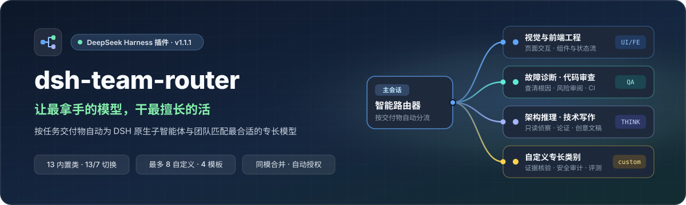
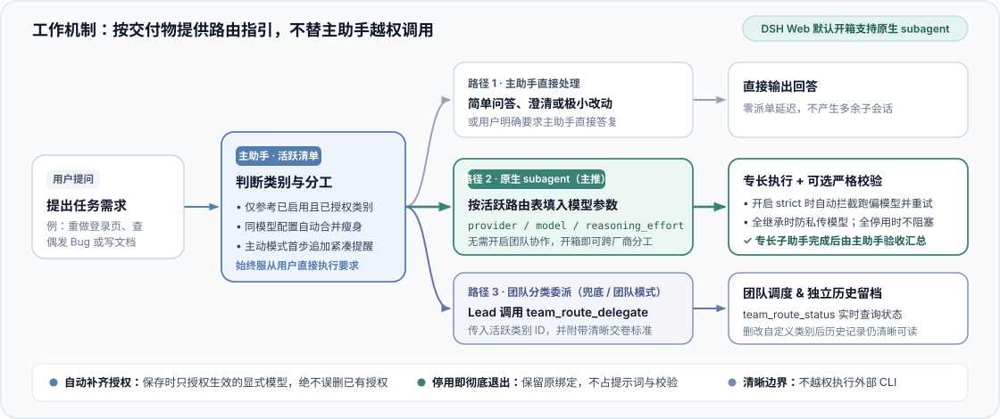
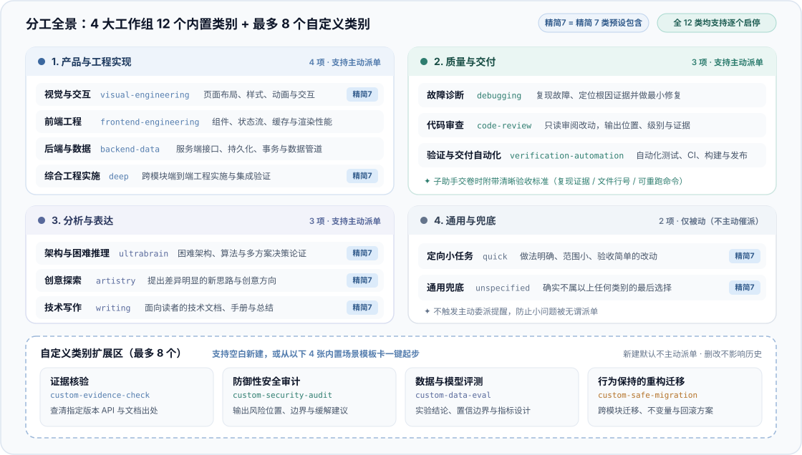
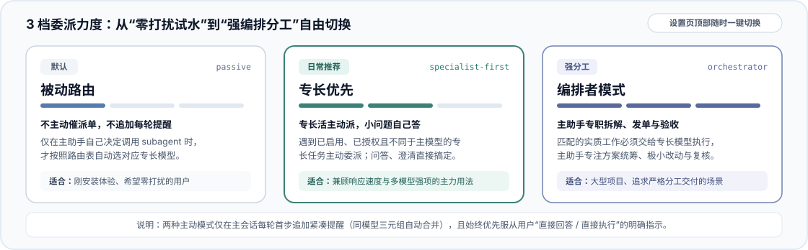

<div align="center">



<p>
  <a href="https://www.npmjs.com/package/dsh-team-router"></a>
  
  =24" />
  <a href="LICENSE"></a>
</p>

<p>
  <strong>给 DeepSeek Harness（DSH）原生子智能体与 Agent Teams 按任务类别自动选模型。</strong><br />
  画界面用视觉强的，排 Bug 用推理稳的，写文档用表达流畅的——配好一次，一个会话里各司其职。
</p>

<p>
  <a href="#-为什么用它">为什么用它</a> ·
  <a href="#-3-步快速上手">3 步上手</a> ·
  <a href="#-工作原理">工作原理</a> ·
  <a href="#-分工全景12-个内置类别--自定义扩展">12 类分工</a> ·
  <a href="#-3-种委派模式怎么选">委派模式</a> ·
  <a href="#-开发与参考">开发与参考</a>
</p>

</div>

---

## 💡 为什么用它？

不同厂商和型号的模型各有强项，但手动切换既打断思路又容易漏配授权。`dsh-team-router` 把“什么活交给哪个模型”变成一套清爽的可视化规则：

| 以前的做法 | 装上 `dsh-team-router` 之后 |
|---|---|
| 全程只用一个模型，画页面、排 Bug、写文档全混着干 | **按交付物自动分流**：不同任务自动匹配对应专长模型 |
| 想换模型得反复切会话、手动折腾子智能体白名单 | **设置页点一点保存**：自动补齐生效模型的 DSH 授权，绝不误删旧权限 |
| 类别一多就刷屏占上下文，模型还容易跑偏 | **同模型自动合并瘦身**，还支持开启**严格校验**防止乱选模型 |
| 业务里有专属场景，固定分类不够用 | **支持最多 8 个自定义类别**，内置 4 张高频模板卡一键起步 |

### ✨ 核心亮点

- **12 个内置专长类别 + 一键精简**：涵盖产品实现、质量交付、分析表达、通用兜底 4 大工作组，支持 **「全部 12 类 / 精简 7 类」** 快捷切换，也能逐个开关任意类别。
- **最多 8 个自定义类别 + 4 张场景模板**：空白新建或一键套用「证据核验 / 防御性安全审计 / 数据与模型评测 / 行为保持的重构迁移」，删改类别不影响历史记录可读性。
- **3 档委派力度 + 严格校验**：从零打扰的「被动路由」到「专长优先」「编排者」随时切换；开启严格校验可拦截不匹配的模型调用并引导重试。
- **开箱友好，绝不越权**：默认全部继承主模型 + 被动模式，装上不会乱派单、不会乱要授权；只负责选模指引与校验，不替主助手执行外部 CLI。

---

## 🚀 3 步快速上手

### 第 1 步：安装插件

**DSH Web（推荐）**
1. 打开 **插件 → 添加插件**，输入 `dsh-team-router@1.0.0`，点击安装并启用。
2. 刷新页面（若提示需要重启，先重启 DSH）。

**命令行安装**（以下以 `web` profile 为例，使用其他 profile 请替换名称）：

```bash
dsh plugin --profile web add dsh-team-router@1.0.0
```

> **如何确认装好了？** 打开同一 profile 的 **插件 → 团队任务路由**，看到 4 组共 12 个内置类别和「自定义类别」配置区，即安装成功。

### 第 2 步：在设置页选好模型并保存

1. 打开 **插件 → 团队任务路由** 或 **设置 → 团队任务路由**。
2. 顶部按习惯选择**委派模式**与是否开启**严格校验**；接着按需设置**默认兜底模型**（默认继承当前会话模型）。
3. 配置各个类别的模型：
   - 想省事：直接点 **「预览推荐配置」**，可按“全部已启用内置类”或“单个工作组”预览与你当前模型目录精确匹配的候选方案，确认差异后再应用到草稿（默认保留你已手动选好的模型，绝不对自定义类别瞎猜）。
   - 想精简：点击 **「精简 7 类」** 或逐个关闭不需要的类别（停用后会彻底退出提示词、校验与授权，但保留原选好的模型方便以后再开）。
   - 有专属需求：在下方 **「自定义类别」** 区新建，或直接套用 4 张场景模板卡。
4. 点击 **保存修改**。插件会自动补齐当前生效显式模型的 DSH 子智能体授权。

> 如果「保存」旁提示模型授权不可用，按页面提示处理后点 **重新检测**；不确定原因可 **复制诊断信息** 发给维护者（检测不会安装插件、修改权限或读取账号信息）。

### 第 3 步：新建会话，立刻生效

保存后**新建一个会话**，系统提示词靠后位置就会带上当前已授权的活跃类别路由表。接下来像平时一样提需求，主助手就会按你的规则让专长模型各展所长。

> [!IMPORTANT]
> **1.0.0 破坏性更新（Breaking Change）与兼容范围**
> - 同一个 `dsh-team-router@1.0.0` 安装包兼容 DSH **`0.2.2-rc.3`、`0.2.2-rc.4`、`0.2.2-rc.5`**（需要 **Node.js 24+**），无需开启版本豁免。
> - 配置已升级为单一的 `routing`（V3）结构，**不再读取或迁移旧版 V1/V2 配置**，并移除旧版 `./policy` 导出、`team_route_set`/`team_route_reset` 及未开放的外部执行器占位字段。升级后在设置页重新点选保存即可；旧版执行历史目录不会被扫描、改写或删除。

> [!NOTE]
> **边界说明**：本插件专注增强 DSH 原生子智能体与团队分工。Codex、agy、Cursor 等外部 Agent 的执行不在本项目范围内，应由独立的 DSH 执行器插件接入；只要它们出现在 DSH 模型目录中，即可直接被本插件路由（详见 [架构说明](docs/ARCHITECTURE.md#范围之外外部执行器)）。

---

## 🔀 工作原理

插件始终遵循**“按主要交付物给主助手清晰指引，不越权代调工具”**的原则，同一份不可变的活跃类别清单驱动全链路：

<p align="center">
  
</p>

- **DSH Web 原生直通**：官方预设默认开启原生 `subagent` 选模能力，无需开启团队协作即可跨厂商分工；混合任务默认由最关键的单一专长模型端到端完成，只在接口明确、可独立验收时拆单。
- **同模合并省上下文**：在主动模式的每轮首步提醒中，插件会按完整的 `(provider, model, reasoningEffort)` 三元组自动合并同配置的类别，既不刷屏，也绝不混并不同推理强度；工具循环后续步与子代理不会重复注入。
- **可选严格校验（`strict: true`）**：拦截不匹配活跃路由表的原生 `subagent` 调用并引导主助手重填。当所有启用类别都为继承时，也会阻止私传显式模型；当全部类别都停用时，插件自动退出拦截，不阻塞宿主。
- **团队工具动态化与兜底**：在未开启 `modelSelection` 的宿主或团队协作模式下，Lead 可调用 `team_route_delegate` 按活跃类别委派（并附带清晰的交卷验收证据要求），随时用 `team_route_status` 查询实时类别与执行历史。

---

## 🧩 分工全景：12 个内置类别 + 自定义扩展

<p align="center">
  
</p>

> 下表为**手动选模参考**（并非「预览推荐配置」的运行时优先序）。未自定义的类别在设置页默认折叠，界面清爽不累眼。

### 1. 产品与工程实现

| 类别 ID | 中文名 | 验收重点 | 精简 7 类 |
|---|---|---|:---:|
| `visual-engineering` | 视觉与交互 | 页面布局、样式、动画与可验证的交互视觉效果 | ✓ |
| `frontend-engineering` | 前端工程 | 客户端组件、状态管理、缓存、路由与渲染性能 | |
| `backend-data` | 后端与数据 | 服务端接口、持久化、事务一致性与数据管道 | |
| `deep` | 综合工程实施 | 不可独立拆交的跨模块工程实施与端到端验证 | ✓ |

### 2. 质量与交付

| 类别 ID | 中文名 | 验收重点 | 精简 7 类 |
|---|---|---|:---:|
| `debugging` | 故障诊断 | 复现故障、定位根因证据，并按要求做最小修复与回归 | |
| `code-review` | 代码审查 | 只读审阅改动，给出带文件位置、级别与证据的风险清单 | |
| `verification-automation` | 验证与交付自动化 | 可重复运行的自动化测试、CI、构建、发布与回滚机制 | |

### 3. 分析与表达

| 类别 ID | 中文名 | 验收重点 | 精简 7 类 |
|---|---|---|:---:|
| `ultrabrain` | 架构与困难推理 | 困难架构、算法与多方案对比决策依据 | ✓ |
| `artistry` | 创意探索 | 提出多种差异明显的创意方向与取舍 | ✓ |
| `writing` | 技术写作 | 面向读者的技术文档、手册、总结与结构化文字 | ✓ |

### 4. 通用与兜底（不参与主动委派）

| 类别 ID | 中文名 | 验收重点 | 精简 7 类 |
|---|---|---|:---:|
| `quick` | 定向小任务 | 做法明确、范围小、验收简单的修改或信息提取 | ✓ |
| `unspecified` | 通用兜底 | 确实不属于上述任何活跃类别的最后选择 | ✓ |

### ✨ 自定义类别（最多 8 个）

在设置页可自由新增最多 8 个自定义类别，填写「什么时候选它」与「什么时候别选它」两句大白话即可上手。首次保存后锁定 `custom-...` ID，展示名随时可改；新建默认关闭主动派单，验证分类准确后再按需开启。插件还自带 **4 张一键场景模板卡**：

- **`custom-evidence-check` 证据核验**：查清指定版本 API 或文档出处，并注明不确定项。
- **`custom-security-audit` 防御性安全审计**：输出风险位置、受影响边界、证据与缓解建议。
- **`custom-data-eval` 数据与模型评测**：交付实验分析结论、置信边界或评测指标设计。
- **`custom-safe-migration` 行为保持的重构迁移**：跨模块迁移，验收行为不变量、兼容窗口与回滚方案。

---

## 🎚️ 3 种委派模式怎么选？

<p align="center">
  
</p>

- **刚装上先试试手感** → 保持默认的 **被动路由（`passive`）**。
- **日常主力开发推荐** → 选 **专长优先（`specialist-first`）**，大活派给专长模型，小问题直接秒答。
- **复杂工程强分工** → 选 **编排者（`orchestrator`）**，让主助手专注拆解与验收，并按需打开 **严格校验（`strict`）**。

> 无论选哪种模式，只要你在对话里明确说“你直接回答 / 你自己改”，主助手都会优先听你的；在桥接环境下也会自动引导调用支持 `provider` / `model` 参数的宿主 `subagent`。

---

## 🛠️ 开发与参考

### 本地开发命令

```bash
npm ci --ignore-scripts     # 安装依赖
npm run check               # 类型检查 + 全量测试 + 构建产物
npm pack --ignore-scripts   # 生成本地安装包
```

### 三层代码结构

源码严格分为三层，[layering.test.ts](test/layering.test.ts) 会在测试时自动拦截越层引用：

- `src/core` — 与宿主无关的类别定义、V3 路由策略、活跃注册表与推荐引擎
- `src/adapter/dsh` — DSH 运行时接线、钩子与动态团队工具（DSH 升级时只需维护此层）
- `src/ui` — 设置页交互、模型选择器与授权诊断面板

### 相关文档

- [V3 配置示例](examples/router.patch.yml)
- [架构说明与宿主触点清单](docs/ARCHITECTURE.md)
- [希望 DSH 提供的上游扩展点提案](docs/UPSTREAM_PROPOSAL.md)
- [1.0.0 实施方案](docs/IMPLEMENTATION_PLAN.md)
- [实现与验证状态](docs/IMPLEMENTATION_STATUS.md)
- [MIT 许可证](LICENSE)

<details>
<summary><strong>维护者发布与多版本 CI 策略（点击展开）</strong></summary>

- [GitHub Actions 发布流水线](.github/workflows/publish.yml) 在面向 `main` 的 PR 和 `main` 推送上运行完整验证，不触发发布。
- CI 只构建一次，把**同一份安装包**独立安装到 `engines.dsh` 列出的每个 DSH 版本中分别跑完整兼容测试；任一版本失败即拒绝发布。
- 另有每日定时运行的 [宿主预警任务](.github/workflows/host-canary.yml)，使用同一份构建对 npm 上最新的 DSH 版本执行全量验证，仅预警、不阻塞发布。
- 当推送与 `package.json`、`package-lock.json` 版本一致的 `vX.Y.Z` 稳定版标签且该提交位于 `main` 上时，CI 才会将已验证的安装包发布到 npm `latest`。

</details>
